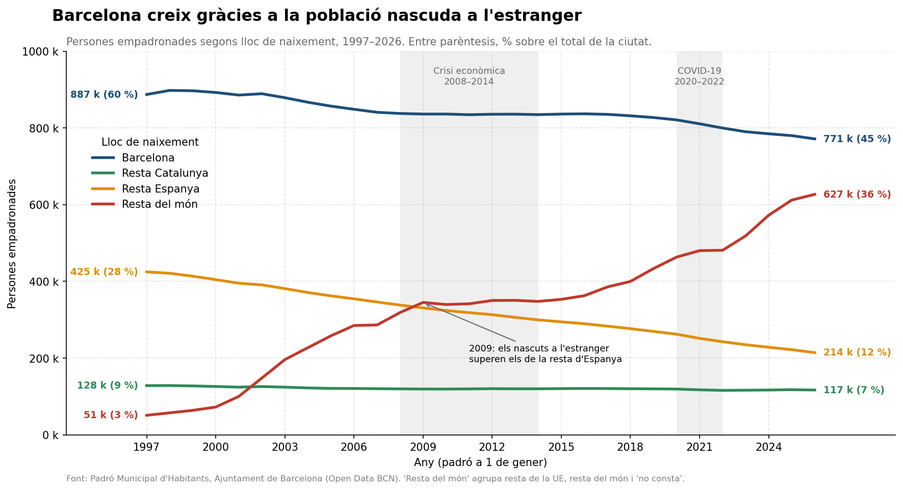
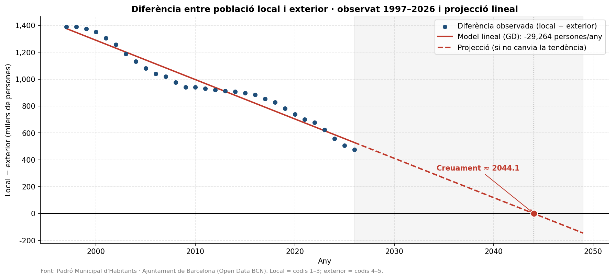

# TNUI · El padró de Barcelona (1997–2026)

Anàlisi exploratòria del **Padró Municipal d'Habitants de Barcelona** i un model de predicció lineal entrenat **des de zero amb gradient descendent**.

Pràctica 1 de l'assignatura **Taller de Nous Usos de la Informàtica (TNUI)** · Universitat de Barcelona.



---

## Preguntes que respon

1. Com ha canviat la composició de la població de Barcelona segons el lloc de naixement entre el 1997 i el 2026?
2. Com són les llars de la ciutat avui (unipersonals, amb menors, gent gran sola)?
3. Quina edat mitjana té cada grup d'origen?
4. **Si no canvien les tendències, quan superarà la població nascuda fora d'Espanya la suma dels nascuts a Barcelona, la resta de Catalunya i la resta d'Espanya?**

## Resultats principals

| Indicador | Resultat |
|---|---|
| Població empadronada | 1,49 M (1997) → **1,73 M** (2026), +16 % |
| Nascuts fora d'Espanya | ~51.000 (3 %) → **~627.000 (36 %)** |
| Nascuts a la resta d'Espanya | 425.000 → 214.000 (es redueixen a la meitat) |
| Domicilis unipersonals (2026) | **31,9 %** |
| Domicilis amb menors (2026) | ~21 % |
| Dones soles ≥ 65 anys vs. homes | gairebé **3 a 1** |
| Edat mitjana: resta d'Espanya vs. resta del món | **65,8** vs. **39,0** anys (mitjana de la ciutat ≈ 44) |
| Model lineal (local − exterior) | −29.264 persones/any |
| **Any de creuament estimat** | **≈ 2044** (≈ 2037 si només es fa servir la dècada 2016–2026) |

El creixement de la ciutat en aquests 30 anys s'explica gairebé del tot per la població nascuda a l'estranger. La predicció del 2044 s'ha de llegir com un ordre de magnitud: la sèrie té trams molt diferents (el boom del 2000–2008, l'aturada per la crisi del 2008 i l'acceleració a partir del 2017), i un model lineal fa la mitjana de tots ells. La discussió completa és a la Part 7 de l'`exercici2.ipynb`.



## Contingut del repositori

```
TNUI/
├── exercici1.ipynb          # Anàlisi exploratòria (neteja, agregació, visualització, informe)
├── exercici2.ipynb          # Regressió lineal amb gradient descendent i projecció
├── data/
│   ├── pad_dimensions.csv           # Diccionari de codis (LLOC_NAIX, SEXE, EDAT_Q, TIPUS_DOMICILI…)
│   ├── poblacio_lloc_naix/          # Un CSV per any, 1997–2026, per secció censal
│   ├── edat_lloc_naix/              # Població per edat quinquennal (2026)
│   └── domicilis_estructura/        # Estructura de les llars (2026)
├── grafic_serie.png         # Sèrie temporal per lloc de naixement
├── grafic_edat_mitjana.png  # Edat mitjana per lloc de naixement
├── grafic_millor.png        # Gràfic final triat i polit (Part 6.2)
├── grafic_projeccio.png     # Diferència observada + recta del model + creuament
├── spec.md                  # Requisits i criteris d'acceptació
├── architecture.md          # Estructura, flux de dades i decisions de disseny
├── tasks.md                 # Tasques de l'exercici 1, pas a pas
└── reglesIA.md              # Regles d'ús de l'assistent d'IA
```

### Exercici 1 — Anàlisi exploratòria

- Càrrega i inspecció dels CSV: tipus, nuls i valors emmascarats `..` (recomptes petits que no es publiquen per privacitat).
- Funció `netejar_poblacio(path)`: converteix `..` en `NaN` (no en 0, per no inventar dades), filtra els codis agregats 1–6 i extreu l'any.
- Agregació a nivell de ciutat amb `groupby`, unió amb el diccionari amb `merge` i taules resum amb `pivot_table`.
- Sèrie temporal 1997–2026 a partir dels 30 fitxers.
- Estructura dels domicilis i indicadors de convivència.
- Edat mitjana ponderada per lloc de naixement, a partir dels punts mitjos dels grups quinquennals.
- Informe final, gràfic triat i una pregunta oberta que aquestes dades no poden respondre.

### Exercici 2 — Model lineal amb gradient descendent

- Comparació de dos grups: **local** (codis 1–3) i **exterior** (codis 4–5).
- Estandardització z-score dels anys i de la diferència.
- Funció de cost MSE i gradients implementats amb numpy, sense scikit-learn.
- Bucle d'entrenament (`lr = 0.1`, 500 iteracions) i corba d'aprenentatge.
- Pas dels paràmetres a l'escala original i validació amb `np.polyfit` (error relatiu 0,00 %).
- Càlcul del punt de creuament `t* = −b / m`, gràfic de la projecció i interpretació crítica.

## Com executar-ho

Cal Python 3 amb `pandas`, `numpy`, `matplotlib` i `jupyter` (amb Anaconda ja hi són tots):

```bash
pip install pandas numpy matplotlib jupyter
git clone https://github.com/Joanfmir/TNUI.git
cd TNUI
jupyter notebook
```

Executa els notebooks **des de l'arrel del repositori** perquè les rutes relatives (`./data`) funcionin, i fes-ho **en ordre**: primer `exercici1.ipynb` i després `exercici2.ipynb`.

## Dades

**Padró Municipal d'Habitants**, Ajuntament de Barcelona, a través d'[Open Data BCN](https://opendata-ajuntament.barcelona.cat/). Les dades són a nivell de **secció censal** i fan servir codis numèrics, que es descodifiquen amb `pad_dimensions.csv`.

## Limitacions

- El padró és un registre administratiu: diu **quanta gent viu on**, però no **per què** arriba o se'n va. No permet fer afirmacions causals.
- Els valors emmascarats (`..`) fan que les sumes quedin lleugerament per sota de les xifres oficials.
- La projecció lineal suposa un ritme de canvi constant, i la mateixa sèrie demostra que no ho és.
